# RadioStar — C4 Model

Status: living document, 2026-11-07. Companion to
[`architecture.md`](architecture.md) (arc42). The arc42 Building Block and
Runtime views are implemented here as C4 context, container, component and
code diagrams.

## 0. How to read this document

C4 uses four levels:

| Level | Question | RadioStar scope |
| --- | --- | --- |
| 1. Context | Who uses the system and which external systems does it depend on? | Phone, user, YouTube Music, laptop, scrobblers, TTS |
| 2. Container | Which runnable units and data stores make up the system? | Android app, playback service, recommendation engine, Room, DataStore, laptop service |
| 3. Component | Which components live inside each container and how do they collaborate? | Recommendation, playback/DJ, import/sync, settings/AI |
| 4. Code | Which classes implement the critical paths? | Repository, scheduler, importer, `MusicService`, DJ runtime |

The diagrams use Mermaid `flowchart`, `sequenceDiagram` and `classDiagram`
syntax. They are deliberately renderer-neutral: no external diagram service is
required. Boundaries named "phone", "laptop" and "external" are trust and
deployment boundaries, not Docker containers.

Non-goals of this model:

- no public multi-user backend;
- no audio library or audio upload;
- no collaborative filtering or model training;
- no web player.

## 1. Level 1 — System Context

RadioStar is a single-user Android application. The phone is the system of
record for history, preferences and generated playlists. The laptop embedding
server is optional compute. External scrobblers are optional and off by
default.

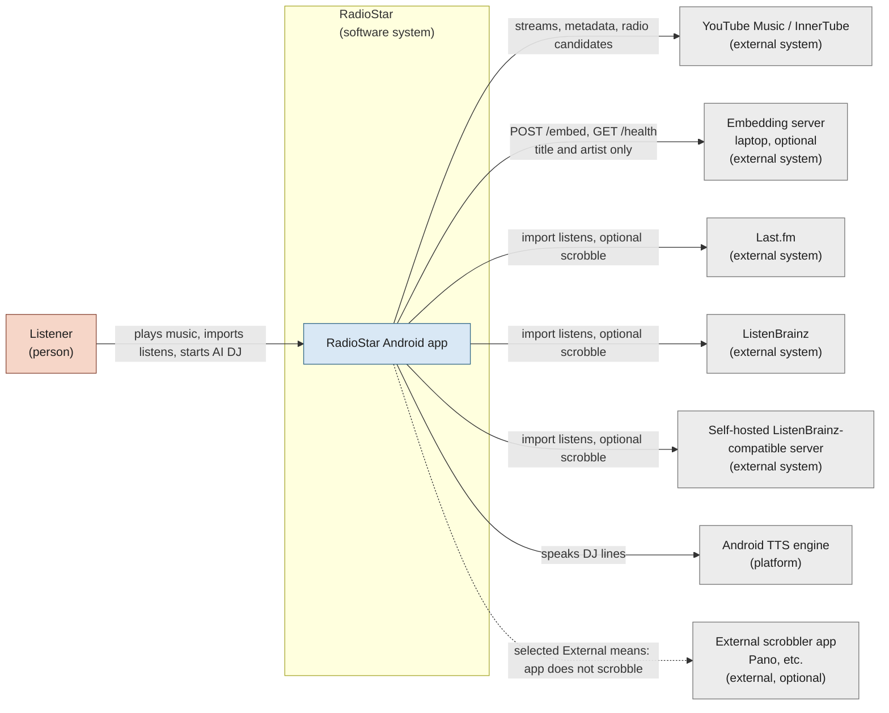

### 1.1 Context notes

- **YouTube Music / InnerTube** is the only audio source. Audio is streamed,
  never stored or redistributed.
- **Embedding server** receives title/artist text only, over HTTPS through
  Cloudflare Tunnel (or Tailscale). It is optional; playback and local analysis
  still work without it.
- **Scrobblers** have two independent roles:
  - **Listens import** pulls history into the phone.
  - **Scrobble service** sends new listens to a chosen destination.
- **External scrobbler** is a destination choice, not an API integration:
  RadioStar stays silent while another Android app scrobbles.
- **Android TTS** is the default DJ voice. No voice model is bundled.

## 2. Level 2 — Container View

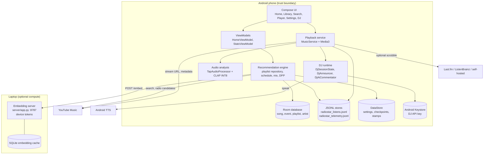

### 2.1 Container responsibilities

| Container | Responsibility | Does not do |
| --- | --- | --- |
| Compose UI | Screens, cards, DJ panel/overlay, settings, progress and status | Queue mutation outside the explicitly started DJ session |
| ViewModels | Home shelf, Stats lists, settings state, DJ queue request | Audio decoding or direct network calls |
| Recommendation engine | Schedule, imported-first anchors, embeddings, DPP slate, persist fixed playlist ids | Play audio or change the current queue |
| Playback service | Media3 player, PCM tap, analysis, TTS, ducking, scrobble dispatch, telemetry hooks | Generate playlists or write recommendation policy |
| Audio analysis | 10 s PCM windows, CLAP INT8, RMS, tempo/key profiles | Store audio or upload audio |
| DJ runtime | Session state, intro/links, persona voice, speaking overlay, AI copy fallback | Change the queue outside a session |
| Room | Library, events, generated songs/artists, playlists | Store audio |
| JSONL stores | Append-only imported listens and local telemetry | Hold secrets |
| DataStore | Preferences, import checkpoints, schedule stamps, last import status | Hold large listen history |
| Keystore | AES/GCM key material for the DJ API key | Store plaintext keys |
| Laptop server | CLAP text tower `/embed`, `/health`, SQLite cache | Receive audio or personal identifiers |

## 3. Level 3 — Component View

### 3.1 Recommendation and scheduling components

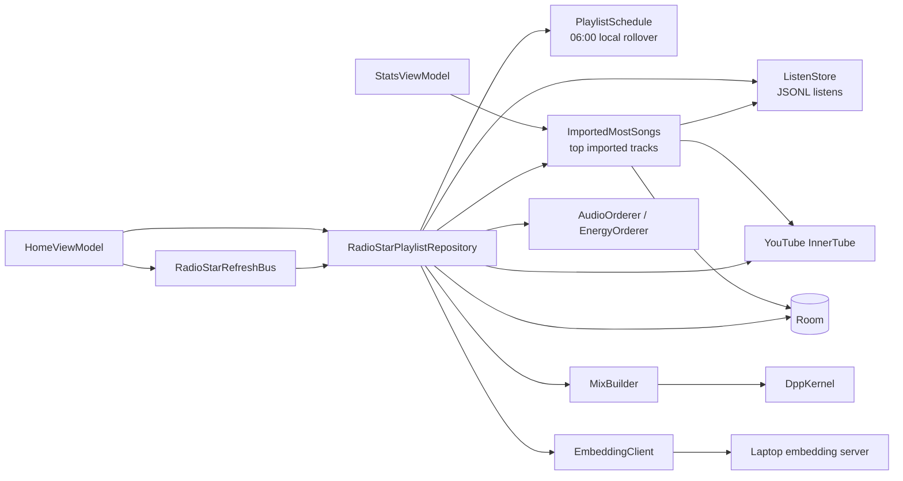

Rules encoded by this component group:

- `PlaylistSchedule` compares the 06:00-based day and ISO week. A successful
  generation writes the stamp; a failure does not.
- Imported listens are the primary anchor source. Local `event` rows are only
  the fallback when no imported history exists.
- The repository writes the same six fixed playlist ids; it never duplicates
  generated playlists.
- `ImportedMostSongs` also feeds the upstream Weekly/Monthly Most playlists.

### 3.2 Playback, analysis and DJ components

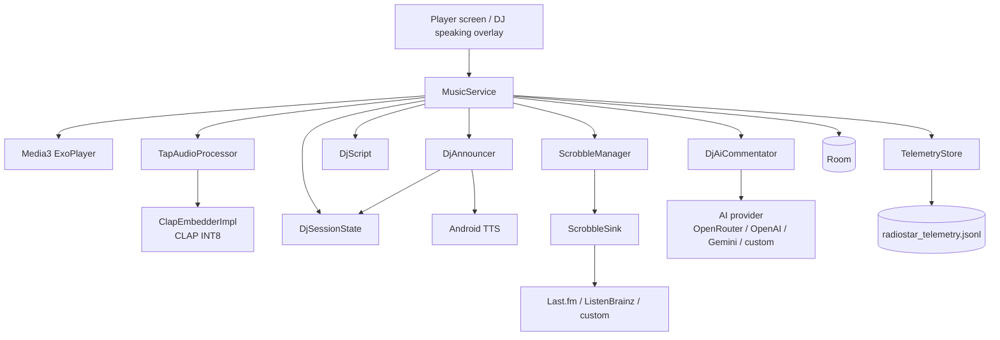

Important behaviour:

- `MusicService` owns the only queue-mutating entry point for a DJ session.
- A DJ start prepares the player paused, speaks the track-aware intro, and
  calls `play()` only from the utterance completion callback.
- Starting any other queue ends the session and stops announcements.
- The overlay is shown only while the player sheet is expanded. Swipe down or
  Back dismisses the overlay for the current utterance.
- `ScrobbleSink` is a no-op when the destination is Off or External.
- `TelemetryStore` writes only when local telemetry is enabled.

### 3.3 Import, sync and history components

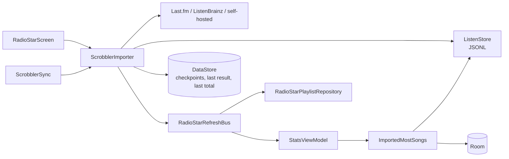

Import semantics:

- Incremental runs read the newest page and stop at the saved timestamp.
- `Incremental check: 100 newest` means the page was newer than the checkpoint,
  not that the service was only partially read.
- If the local service count is below the service total, the importer rebuilds
  from zero as a repair.
- A completed import clears Weekly/Monthly Most stamps and requests a playlist
  refresh.
- Settings shows local count, service total, last check and the incremental
  explanation.

### 3.4 Settings, AI and secure storage

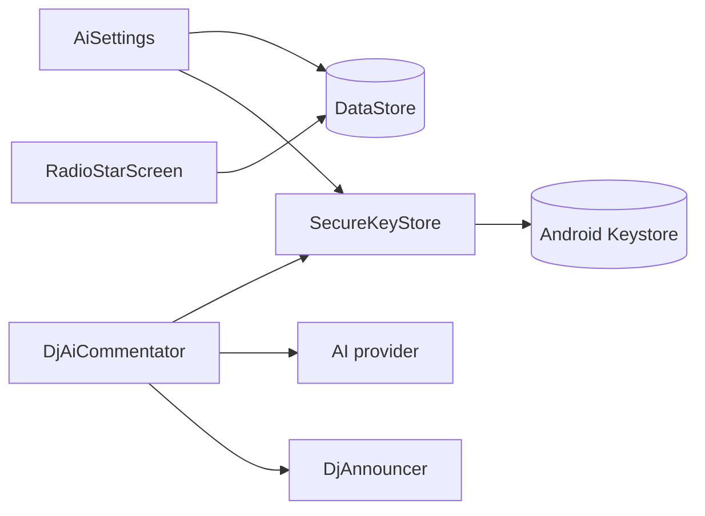

- The AI provider, model and DJ key live in **Settings → AI → DJ commentary**.
- Gemini is the default DJ provider; model and base URL are configurable.
- The DJ key is AES/GCM-encrypted with an Android Keystore key.
- Turning **AI DJ** off removes the DJ card, panel, overlay, AI DJ group and
  all announcements.

## 4. Level 4 — Code and Dynamic Views

### 4.1 Playlist refresh sequence

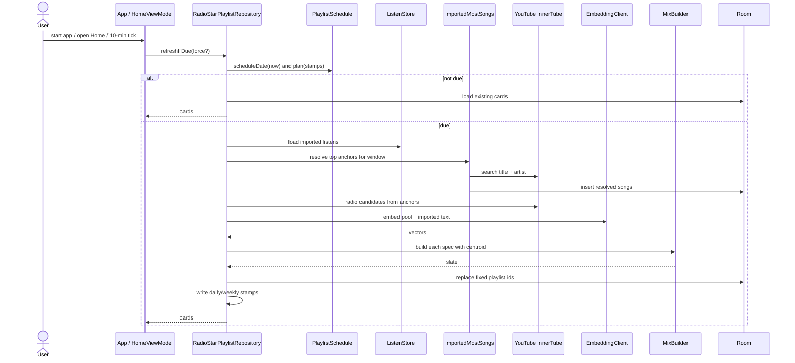

### 4.2 DJ start sequence

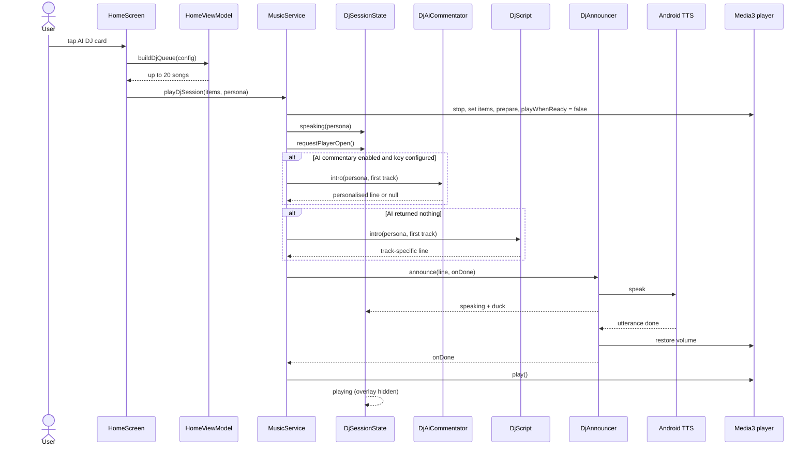

### 4.3 Import sequence

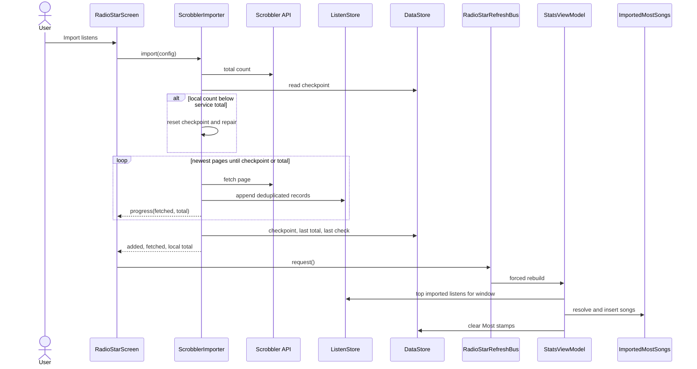

### 4.4 Critical classes

```mermaid
classDiagram
    class RadioStarPlaylistRepository {
        +cards: StateFlow
        +refreshIfDue(force: Boolean)
        +buildDjQueue(config: DjConfig): List
    }
    class PlaylistSchedule {
        +scheduleDate(now: LocalDateTime): LocalDate
        +plan(today, dailyStamp, weeklyStamp, force): PlaylistRefreshPlan
    }
    class ImportedMostSongs {
        +topListens(listens, since, limit): List
        +resolve(context, database, since, limit): List
    }
    class ListenStore {
        +load(): List
        +append(records): Int
        +count(): Int
    }
    class MixBuilder {
        +build(session, candidates, kind, k, historyIds, historyKeys): List
    }
    class DppKernel {
        +select(kernel, k): List
    }
    class EmbeddingClient {
        +embed(server, items): List
    }
    class MusicService {
        +playDjSession(items, persona)
        +playQueue(queue, playWhenReady, restoringQueue)
        +adoptQueue(queue, title, initialQueueSize)
    }
    class DjSessionState {
        +state: StateFlow
        +speaking(persona)
        +playing(persona)
        +dismissSpeaking()
        +idle()
    }
    class DjAnnouncer {
        +prepare()
        +announce(text, id, onDone): Boolean
        +shutdown()
    }
    class ScrobblerImporter {
        +import(context, config, onProgress): ListenImportResult
    }
    class ScrobbleSink {
        +nowPlaying(context, artist, track, album, durationSeconds)
        +scrobble(context, artist, track, album, durationSeconds, timestampSeconds)
    }
    class TelemetryStore {
        +record(context, event)
        +count(context): Int
        +clear(context): Boolean
    }

    RadioStarPlaylistRepository --> PlaylistSchedule
    RadioStarPlaylistRepository --> ImportedMostSongs
    RadioStarPlaylistRepository --> ListenStore
    RadioStarPlaylistRepository --> MixBuilder
    MixBuilder --> DppKernel
    RadioStarPlaylistRepository --> EmbeddingClient
    MusicService --> DjSessionState
    MusicService --> DjAnnouncer
    MusicService --> ScrobbleSink
    MusicService --> TelemetryStore
    ScrobblerImporter --> ListenStore
```

## 5. Deployment View

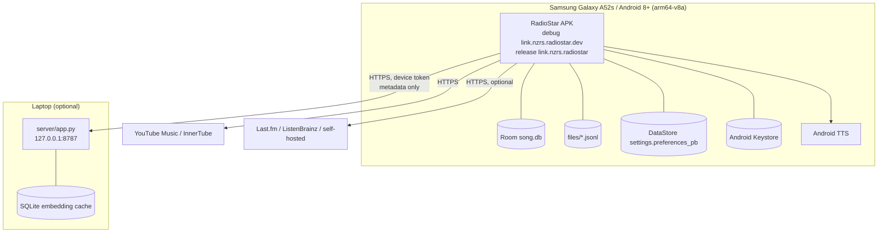

Deployment notes:

- Release APKs are unsigned in this repository; no store distribution.
- The laptop server requires authentication and is intended for the owner's
  devices. It binds loopback and is published through Cloudflare Tunnel or
  Tailscale with HTTPS.
- Without the laptop, playback, DJ and local analysis work; new text-embedding
  playlists wait until the server is reachable.
- Scrobble tokens stay on the phone. The DJ API key is additionally encrypted.

## 6. Mapping to arc42

| arc42 section | C4 view in this document |
| --- | --- |
| 1. Introduction and Goals | Level 1 context and scope |
| 2. Constraints | Deployment and trust boundaries |
| 3. Context and Scope | Level 1 context |
| 4. Solution Strategy | Container responsibilities and component rules |
| 5. Building Block View | Levels 2 and 3 |
| 6. Runtime View | Level 4 sequences |
| 7. Deployment View | Deployment diagram |
| 8. Cross-cutting Concepts | Security, privacy and failure notes in each view |
| 9. Architecture Decisions | Decisions referenced from component rules |
| 10. Quality Requirements | Scenarios in `architecture.md` |
| 11. Risks and Technical Debt | Risks in `architecture.md` |

## 7. Deliberate boundaries

- **Playlists are artifacts.** The recommendation engine writes rows; it does
  not mutate the active queue.
- **The DJ session is the only queue exception.** It is started explicitly,
  owns an empty backing queue, and ends when the user starts another queue.
- **Imported history is primary.** Local Metrolist events are the fallback for
  users without an import source.
- **Generation is scheduled.** The playlist day starts at 06:00 local; the
  generator is idempotent and writes stamps only on success.
- **Scrobbling is off by default.** Import source and scrobble destination are
  independent settings.
- **Telemetry is local and opt-in.** No event leaves the device.

## 8. Related documents

- [`architecture.md`](architecture.md) — arc42 structure and quality goals.
- [`decisions.md`](decisions.md) — numbered decisions D-01..D-20.
- [`CREDITS.md`](CREDITS.md) — app, model, data and artwork credits.
- [`spike.md`](spike.md) — closed research spike and evidence.
